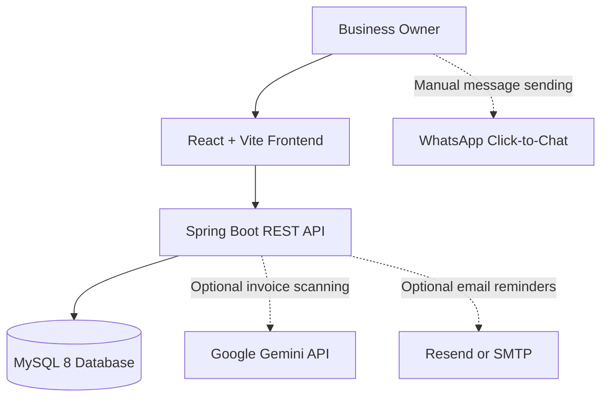

# Baaki — Know Who to Chase This Week

**Baaki** is a smart accounts receivable and payment-follow-up platform designed to help small businesses manage unpaid invoices, communicate with customers, generate GST invoices, reconcile payments, and forecast future cash flow.

🌐 **Live Demo:** https://baaki-zple.onrender.com/

💻 **GitHub Repository:** https://github.com/rithikraja61-ctrl/baaki

> **Project type:** Hackathon prototype  
> **Sample business:** Sharma Packaging, Pune (fictional business)  
> **Languages:** English, हिंदी, मराठी

Baaki helps business owners understand which payments need attention, whom to follow up with, and how outstanding invoices affect expected cash flow.

**Note:** This project uses fictional demonstration data. It does not connect directly to a live bank or GST portal. Email reminders can use configured providers, while WhatsApp messaging currently uses a manual click-to-chat link. Automated WhatsApp messaging is not implemented.

---

## Table of Contents

- [Problem Statement](#problem-statement)
- [Our Solution](#our-solution)
- [Key Features](#key-features)
- [Technology Stack](#technology-stack)
- [Architecture](#architecture)
- [Run Locally with Docker](#run-locally-with-docker)
- [Environment Configuration](#environment-configuration)
- [Automatic Email Reminders](#automatic-email-reminders)
- [WhatsApp Integration](#whatsapp-integration)
- [AI-Powered Invoice Scanning](#ai-powered-invoice-scanning)
- [Financial Rules and Localization](#financial-rules-and-localization)
- [Testing and Development](#testing-and-development)
- [Project Structure](#project-structure)
- [Security and Limitations](#security-and-limitations)
- [Future Improvements](#future-improvements)
- [License](#license)

---

## Problem Statement

Small businesses frequently sell products or services on credit. Tracking outstanding invoices, remembering due dates, contacting customers, and estimating future cash availability can become difficult when these activities are managed manually.

Late payments can affect working capital, while inconsistent follow-ups and manual invoice processing consume valuable time.

## Our Solution

Baaki brings receivables management into a single workspace. It organizes outstanding invoices, prioritizes follow-ups, supports GST invoice creation, provides payment reconciliation workflows, and forecasts cash flow for the next 13 weeks.

The goal is to help small-business owners make better follow-up decisions and reduce the administrative work involved in collecting payments.

## Key Features

### 1. Today's Follow-ups

- Identify invoices that require attention.
- Organize payment follow-ups according to their status and reminder stage.
- Provide customer communication options.
- Track relevant follow-up activity and customer responses.
- Avoid inappropriate automated reminders for disputed, snoozed, or promised invoices.

### 2. GST Invoice Management

- Create invoices with customer and item details.
- Calculate GST at the invoice-line level.
- Support CGST, SGST, IGST, and round-off handling.
- Generate invoice numbers according to the financial year.
- Provide public invoice links and payment links.
- Support English invoices with an optional second-language translation.

### 3. Payment Demand Letters

- Prepare payment-demand letters for overdue invoices.
- Allow the business owner to review the content before sending.
- Keep payment-demand letters under manual control rather than sending them automatically.

### 4. Payment Reconciliation

- Match bank-credit entries against outstanding invoices.
- Help the owner understand which invoices remain unpaid.
- Support the receivables workflow without a direct live-bank connection.

### 5. Thirteen-Week Cash-Flow Forecast

- Provide a forward-looking view of expected cash flow.
- Help owners understand how outstanding payments affect anticipated cash availability.
- Support planning around expected customer payments.

### 6. AI-Powered Invoice Scanning

- Upload a JPG, PNG, or PDF of an existing invoice, up to 5 MB.
- Extract invoice details using the Google Gemini API.
- Read fields such as invoice number, customer, GSTIN, line items, tax values, and total amount.
- Validate extracted information and highlight uncertain fields.
- Require owner review before the invoice can be saved.

### 7. Automatic Email Reminders

- Configure email delivery through Resend or SMTP.
- Schedule eligible reminders for 10:00 AM India Standard Time.
- Test delivery using the test mode.
- Track sending attempts, failures, and skipped messages.
- Retry failed reminders after the application rechecks the relevant rules.

### 8. WhatsApp Click-to-Chat

- Open WhatsApp with a prefilled customer message.
- Let the business owner review and send the message manually.
- Avoid claiming automated WhatsApp delivery, which is not implemented in the current prototype.

### 9. Multilingual Experience

The interface supports three languages:

- English
- हिंदी — Hindi
- मराठी — Marathi

Customers can have a preferred language for reminders and payment links. Invoice and payment-demand letter translations can also be configured through Settings.

### 10. Demo Mode

- Explore the application using fictional business and customer records.
- Use the demo date setting to demonstrate date-dependent workflows.
- Reset the demo data through the application's supported reset workflow.

---

## Technology Stack

| Component | Technology |
|---|---|
| Frontend | React 18 |
| Frontend tooling | Vite |
| Styling | Tailwind CSS |
| Backend | Java 21 |
| Backend framework | Spring Boot 3.5 |
| Data access | Spring Data JPA |
| Validation | Jakarta Bean Validation through Spring Boot |
| Database | MySQL 8 |
| Database migrations | Flyway |
| AI invoice extraction | Google Gemini API |
| Email delivery | Resend API or SMTP |
| Containerization | Docker |
| Local orchestration | Docker Compose |

---

## Architecture



The frontend communicates with the Spring Boot API. The API manages business logic and database operations. Gemini and email delivery are optional integrations configured on the backend.

WhatsApp currently opens a prefilled message for the owner to send manually.

---

## Run Locally with Docker

Docker Compose starts the frontend, backend API, and MySQL database. You do not need to install Java, Maven, Node.js, or MySQL separately for this setup.

### Prerequisites

- Git
- Docker Desktop or Docker Engine
- Docker Compose

### Step 1: Clone the repository

```powershell
git clone https://github.com/rithikraja61-ctrl/baaki.git
cd baaki
```

### Step 2: Start the application

```powershell
docker compose up -d --build
```

### Step 3: Open the application

| Service | Local address |
|---|---|
| Baaki frontend | http://localhost:5190 |
| Backend API | http://localhost:8090/api |
| MySQL | `localhost:3310` |

Flyway initializes the database schema and sample data during application startup.

The repository's Docker Compose configuration uses development database credentials for the local demo. These credentials are not suitable for production.

### Useful Docker commands

Check running containers:

```powershell
docker compose ps
```

View backend logs:

```powershell
docker compose logs -f backend
```

Stop the application while retaining the named database volume:

```powershell
docker compose down
```

Stop the application and delete the local database volume:

```powershell
docker compose down -v
```

**Warning:** The last command deletes the database data stored in the Docker volume.

---

## Environment Configuration

The repository contains a root `.env.example` file describing the optional integrations used by Docker Compose.

For the basic local demo, email can remain disabled. Configure `.env` only when you need optional integrations.

### Configuration variables

| Variable | Purpose |
|---|---|
| `MAIL_PROVIDER` | Select `none`, `resend`, or `smtp` |
| `MAIL_FROM` | Sender email address |
| `RESEND_API_KEY` | API key for Resend |
| `SMTP_HOST` | SMTP server hostname |
| `SMTP_PORT` | SMTP port |
| `SMTP_USERNAME` | SMTP account username |
| `SMTP_PASSWORD` | SMTP account password or app password |
| `PUBLIC_BASE_URL` | Public application URL used to construct invoice and payment links |
| `AI_API_KEY` | Google Gemini API key |
| `AI_MODEL` | Gemini model for image and PDF processing |
| `GOOGLE_CLIENT_ID` | Google OAuth web client ID |

### Configure optional services

Copy the example configuration:

```powershell
Copy-Item .env.example .env
```

Open `.env` and update the variables for the integrations you plan to use.

For local use without email credentials, set:

```dotenv
MAIL_PROVIDER=none
```

After changing backend environment values, rebuild the backend:

```powershell
docker compose up -d --build backend
```

**Security:** Keep `.env` out of version control. Never commit API keys, SMTP credentials, database passwords, or other secrets.

---

## Automatic Email Reminders

Baaki's scheduled email reminder job runs daily at **10:00 AM Asia/Kolkata time**. It runs within the backend API container.

### Setup

1. Configure `.env` with `MAIL_PROVIDER=resend` or `MAIL_PROVIDER=smtp`.
2. Set `MAIL_FROM` and the required provider credentials.
3. Set `PUBLIC_BASE_URL` to the public address customers should use.
4. Rebuild the backend:

   ```powershell
   docker compose up -d --build backend
   ```

5. Open **Settings → Automatic email reminders**.
6. Configure the owner's email address and leave **Test mode** enabled for the initial test.
7. Use **Send today's reminders now** to trigger a test without waiting for the scheduled time.

### Reminder rules

- Only reminder steps enabled under **Email automatically** in Settings are eligible for automatic email.
- Payment Demand Letters and Next Steps are not sent automatically.
- A reminder step is not sent twice for the same invoice.
- Disputed, snoozed, or promised invoices are skipped.
- An invoice is skipped when a customer reply is waiting in the Inbox.
- The application applies rules to avoid multiple messages to the same customer on a given day.
- Send attempts are recorded in `send_log` with statuses such as `SENDING`, `SENT`, `FAILED`, or `SKIPPED`.
- Failed sends can appear in Today's Follow-ups for review and retry.
- Test-mode messages are sent to the owner's email address and marked as tests. They do not advance the reminder sequence.
- With Resend, attempts use an `Idempotency-Key` to help prevent duplicate delivery from retrying the same request.

Emails can include links to view the invoice and pay online, along with the appropriate contact information.

---

## WhatsApp Integration

The current implementation uses a **WhatsApp `wa.me` click-to-chat link**. It opens the owner's WhatsApp with a prefilled message, which the owner can review and send.

Automated WhatsApp messaging is not implemented in this prototype.

A future automated integration would require the WhatsApp Business Platform or an appropriate Business Solution Provider, business setup, approved message templates, and applicable message charges.

Payment Demand Letters would remain manual-send actions.

### Example message templates for a potential future integration

The following are examples of reminder messages that could be adapted for approved WhatsApp Business templates. They are not evidence that automated WhatsApp sending is currently enabled.

1. **Invoice heads-up:** Hello {{1}}, a friendly note from {{2}}: invoice {{3}} for {{4}} is due on {{5}}. View and pay: {{6}}. Questions? Contact {{7}} on {{8}}.

2. **Invoice due today:** Hello {{1}}, invoice {{2}} for {{3}} from {{4}} is due today. Pay here: {{5}}. Questions? Contact {{6}} on {{7}}.

3. **Overdue reminder:** Hello {{1}}, invoice {{2}} for {{3}} from {{4}} is {{5}} days past its due date. Please let us know when we can expect payment, or pay here: {{6}}. Questions? Contact {{7}} on {{8}}.

4. **Final reminder:** Dear {{1}}, this is our final reminder for invoice {{2}}: {{3}} is {{4}} days overdue. Please pay within 3 days or call {{5}} on {{6}} to agree a date. Pay here: {{7}}. {{8}}.

5. **Payment received:** Hello {{1}}, we have received {{2}} against invoice {{3}}. Thank you for your payment. Questions? Contact {{4}}, {{5}}, on {{6}}.

These are proposed message examples, not approved Meta templates. Any future production integration must follow the applicable platform requirements.

---

## AI-Powered Invoice Scanning

Baaki can extract information from an existing paper invoice or PDF using Google Gemini.

### How to use it

1. Get an API key from [Google AI Studio](https://aistudio.google.com/apikey).
2. Set `AI_API_KEY` in the root `.env` file.
3. Optionally configure `AI_MODEL`. The default in the example configuration is `gemini-flash-latest`.
4. Rebuild the backend:

   ```powershell
   docker compose up -d --build backend
   ```

5. In the app, open **New invoice → Add an existing invoice from a photo**.
6. Choose a JPG, PNG, or PDF file up to 5 MB.
7. Review the extracted fields and resolve all highlighted issues before saving.

### How it works

The browser uploads the invoice to:

```text
POST /api/invoices/scan
```

The backend calls Google Gemini using `AI_API_KEY`, so the API key does not need to be exposed to the frontend.

The scan workflow extracts information such as:

- Invoice number and date
- Customer details and GSTIN
- Items, HSN/SAC, quantities, and rates
- Taxable values and applicable tax amounts
- CGST, SGST, and IGST
- Round-off and invoice total
- Printed due date, where available

### Validation and manual review

Baaki checks the extracted information before the owner saves the invoice. The validation process includes:

- GSTIN check-digit validation
- GST recalculation from the invoice items
- Comparison with printed totals, with a ₹1 tolerance
- Customer matching by GSTIN and then by name
- Flags for duplicate invoice numbers, potentially outdated GST rates, and short HSN codes

Fields that are uncertain or fail validation are highlighted. Saving remains locked until the highlighted fields are resolved and the owner confirms that every field has been compared.

The scan workflow processes the uploaded file in memory and does not intentionally save it to disk or the database.

**Important:** AI-generated extraction is a starting point for review, not a substitute for checking the original invoice or obtaining professional accounting advice.

Relevant implementation areas include `backend/.../scan/`, `web/ScanController.java`, and `frontend/src/components/ScanInvoice.jsx`. The invoice scan tests include `InvoiceScanTest`.

---

## Financial Rules and Localization

### Financial calculations

- Monetary amounts are stored as `BIGINT` paise.
- GST is calculated per invoice line using the taxable value.
- CGST and SGST are rounded separately.
- The grand total is rounded to the rupee, with a separate round-off line.
- Invoice numbers follow a financial-year sequence, such as `INV/26-27/0001`.
- Invoice sequence allocation uses `SELECT ... FOR UPDATE` to protect sequence generation.
- The financial year runs from 1 April to 31 March.
- A Spring `Clock` bean supports the Demo Date configured in Settings.
- GST rates, the RBI bank-rate setting, and the payment-demand-letter deadline are configured in `backend/src/main/resources/application.yml`.

### Language support

The frontend language resources are maintained in:

```text
frontend/src/i18n/en.js
frontend/src/i18n/hi.js
frontend/src/i18n/mr.js
```

The application supports English, Hindi, and Marathi. Customer language preferences can influence reminders and payment-link pages. In Settings, the owner can also choose whether invoices and letters should include a second-language translation.

Reminder wording is maintained in `reminder-templates.json`. Keep the frontend and backend copies synchronized when modifying reminder messages.

Sample customers have language preferences configured through the language migration, including Marathi and Hindi preferences.

---

## Testing and Development

### Backend tests

The backend uses Spring Boot's test dependencies and JUnit.

Install Java 21 and Maven, then run:

```powershell
cd backend
mvn test
```

The Dockerfile currently uses Maven with tests skipped during its image build, so run `mvn test` separately when you need to execute the test suite.

### Frontend development

Install Node.js, then run:

```powershell
cd frontend
npm install
npm run dev
```

For a complete local demonstration with the frontend, backend, and database, use Docker Compose.

---

## Project Structure

```text
baaki/
├── backend/              # Java 21 + Spring Boot API
├── frontend/             # React + Vite application
├── docs/                 # Project documentation
├── gen/                  # Generated/project support files
├── docker-compose.yml    # Local frontend, API, and MySQL services
├── .env.example          # Optional integration configuration
└── README.md             # Project documentation
```

---

## Security and Limitations

Baaki is a hackathon prototype and should not be treated as a production accounting system without further hardening.

Before using real customer or financial information:

- Replace development database credentials and use managed secrets.
- Enable HTTPS and restrict database network access.
- Review authentication, authorization, and production CORS settings.
- Protect API keys and SMTP credentials.
- Verify sender domains and public invoice/payment URLs.
- Test database backups, restoration, access controls, and email delivery.
- Verify all financial and tax calculations against applicable requirements.
- Review data retention, privacy, and applicable legal obligations.
- Do not treat AI-extracted invoice data as automatically correct.
- Do not assume that direct bank integrations, GST portal connectivity, or automated WhatsApp messaging are available.

---

## Future Improvements

Potential areas for further development include:

- Production-ready deployment and secret management
- Automated WhatsApp Business Platform integration
- More robust payment reconciliation workflows
- Additional reporting and receivables analytics
- Enhanced audit trails and role-based access controls
- Stronger integration and end-to-end testing
- Production-grade backup, monitoring, and error reporting

These are potential improvements, not claims about functionality already delivered.

---

## License

No license is specified in this README. Review the repository's license file or GitHub repository settings before reusing or redistributing the code.

---

**Try Baaki:** https://baaki-zple.onrender.com/

**Source code:** https://github.com/rithikraja61-ctrl/baaki
